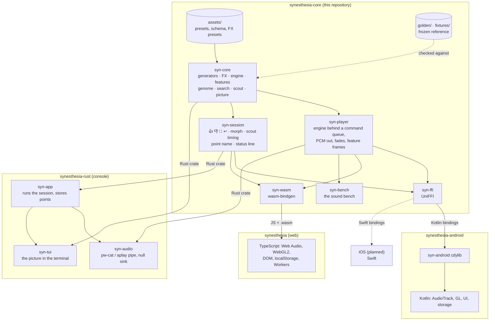

# Synesthesia — core

The portable model of [Synesthesia](https://github.com/dmitryweiner/synesthesia):
one point in a ~500-gene space makes sound (23 formula generators, an FX
chain, 4 shared LFOs, and up to four layers of recorded samples and drums
in Strudel-style rhythms) and a picture (Gray–Scott reaction-diffusion
driven by the sound), and 👍/👎 steer the search through it. The samples
are CC0 / public domain, in
[synesthesia-samples](https://github.com/dmitryweiner/synesthesia-samples)
(`bank.bin`, its release `bank-v1`); the core takes them as bytes.

**How it works** — one page per part, in [`docs/`](docs/README.md):

- [Generators](docs/generators.md) — the 23 formula synthesizers and their sliders
- [Sample and drum layers](docs/layers.md) — recorded sounds and synth drums in
  mini-notation rhythms, the sample bank
  ([listen to the samples](https://dmitryweiner.github.io/synesthesia-samples/))
- [LFOs and modulation](docs/lfo.md) — the four LFOs, their shapes, the routes
- [Effects](docs/effects.md) — filter, chorus/flanger, phaser, delay with shimmer,
  reverb, limiter; effect presets
- [Space and binaural beats](docs/binaural.md) — stereo for headphones: voices
  around the head, width, the binaural beat
- [The picture](docs/picture.md) — reaction-diffusion, palette, how the sound
  drives it, the flash guard
- [Points, search and presets](docs/search.md) — the point and its genes,
  👍 👎 🎲 ↩, the morph, the scout, presets, share links

It is Rust with no I/O and no threads of its own. Three apps run on it
today, each one *device + screen + storage* around the same model, each
pinning a git revision of this repository:

| app | how it uses the core | where the revision is pinned |
|---|---|---|
| [synesthesia](https://github.com/dmitryweiner/synesthesia) (web) | `syn-wasm` (wasm-bindgen) in its AudioWorklet, picture and points Worker; on the core since 2026-10-06 (its PLAN-CORE.md) | `synesthesiaCore.rev` in `package.json` |
| [synesthesia-android](https://github.com/dmitryweiner/synesthesia-android) | `syn-ffi` (UniFFI → Kotlin), linked into its own `syn-android` cdylib | `core/rust/Cargo.toml` |
| [synesthesia-rust](https://github.com/dmitryweiner/synesthesia-rust) (console) | `syn-core`, `syn-player` and `syn-session` as Rust crates, with its own device (a `pw-cat` or `aplay` pipe; a null sink for soak runs without sound) and TUI (`syn-core` was born there) | workspace `Cargo.toml` |
| iOS (planned) | `syn-ffi` (UniFFI → Swift) | — |



This repository is the **specification** (since 2026-10-05; the web app's
PLAN-CORE.md C2): ranges, defaults, presets and the gene list are written
here (`assets/`), and a new preset or generator is made here first. What
the web app's TypeScript did while it was the specification is frozen:
the generators' takes (`golden/`) and its handling of points, measurements
and status lines (`fixtures/`).

## Layout

```
syn-core/   the model: generators, modulation, FX, engine, features,
            analysis, the point, the genome, the search, the scout, the
            sequencer layers (`seq/`: mini-notation, patterns, the sample
            bank, voices, synth drums), the picture (`sim/`: the CPU one,
            the per-frame driver every renderer shares, the flash guard,
            the quality ladder). No I/O, no threads, deterministic.
syn-player/ the render side every app shares: the engine behind a command
            queue, PCM out in any chunk size (mono, or stereo for
            headphones), fades, feature frames on the played clock
syn-session/ the control logic every app shares: 👍 👎 🎲 ↩, the morph, when
            the scout may render, the point's name, the status line. Pure:
            `tick(now)` and commands in, effects out
syn-ffi/    the foreign interface (UniFFI): records, functions, the live
            player, the session and the picture an app calls; the Kotlin
            and Swift bindings are generated from it
syn-wasm/   the same for JavaScript (wasm-bindgen): the web app's
            AudioWorklet, Web Workers and points Worker load it
syn-bench/  the sound bench: render points and measure them (fractality,
            character, onsets, clicks at switches, render configs, PNGs,
            the layers' cost, the picture's flashes, listening drafts,
            the stereo engine's cost and checks)
syn-noalloc/ test only: a counting allocator proves the render path
            allocates nothing
assets/     presets.json, schema.json, fx-presets.json — the source, edited here
golden/     63 reference takes of the 21 generators, rendered by the web app;
            golden/drums/: the five synth drums' takes
fixtures/   the TypeScript's behaviour, frozen: points (sanitize, canonical
            JSON, ids), status lines, measurements, preset genomes
docs/       how it works, one page per part (generators, layers, LFOs,
            effects, space and binaural beats, picture, search)
scripts/    check.sh; dump-points.mjs and dump-analysis.mjs (need ../synesthesia,
            and only until its TypeScript model is deleted)
TODO.md     agreed follow-ups that are not done yet
```

## Checking it

```bash
rustup update stable    # CI uses the latest stable; an older clippy misses its lints
rustup target add wasm32-unknown-unknown
cargo install wasm-bindgen-cli --version 0.2.129   # the version syn-wasm pins
./scripts/check.sh      # fmt --check, clippy -D warnings, every test (syn-wasm's under node)
```

- **The 23 generators are diffed sample by sample** against the 69 golden
  takes; they match to the last bit or two (worst difference 1.6e-16 as of
  2026-10-05, after Additive and Shepard were rewritten for speed).
- **The genome is the web app's genome**: every preset encodes to the same
  250 genes to 1.1e-16; the 33 genes of the layers and the 30 of space and
  the binaural beat are appended after them (313 in all), and a point
  without layers or space adds only their default tail.
- **Nothing allocates in `Engine::render` or `render_stereo`**
  (`syn-noalloc`); **the stereo engine at width 0 with the beat off is the
  mono one**, bit for bit; and **the picture never strobes**:
  `syn-bench --flashes` counts flashes the WCAG 2.3.1 way, every preset at
  most one a second.
- **The picture** has no reference samples (the browser seeds it with
  `Math.random()`); its invariants are the contract.

## Using it from an app

An app pins a revision of this repository and builds its own `cdylib` that
links `syn-ffi`; the bindings are generated from that library with the
`uniffi-bindgen` this crate provides (feature `cli`), so the generator and
the scaffolding are always the same UniFFI version:

```toml
[dependencies]
syn-ffi = { git = "https://github.com/dmitryweiner/synesthesia-core", rev = "…" }
```

The Android app's `core/rust/` (`syn-android` + `uniffi-bindgen`) and its
`core/build.gradle.kts` are the worked example.

The web app pins a revision in its `package.json` (`synesthesiaCore.rev`)
and builds `syn-wasm` with `wasm-pack build syn-wasm --target web` (its
`scripts/build-core.mjs`). The console depends on `syn-core`, `syn-player`
and `syn-session` directly, all three at one `rev` in its workspace
`Cargo.toml` (its PLAN.md decisions 11 and 12).

## History

`syn-core`, `assets/` and `golden/` were moved here from synesthesia-rust
with their history (`git filter-repo`); the decisions behind them are in
that repository's PLAN.md and GRAPHICS.md. The decisions behind this split
are in synesthesia-android's PLAN.md (decisions 1 and 2).

## License

GPL-3.0, see [LICENSE](LICENSE).
