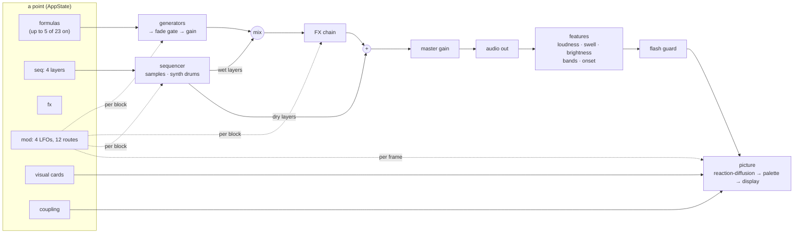

# How Synesthesia works

These pages describe what the model *does*: how a point turns into sound
and a picture, and what each part of it means. The project map and the
working rules for changing the code are in [AGENTS.md](../AGENTS.md); the
decisions behind work in progress are in the plan files next to it.

| page | what it covers |
|---|---|
| [Generators](generators.md) | the 23 formula generators: what each one computes and what its sliders do |
| [Sample and drum layers](layers.md) | four layers of recorded sounds and synth drums, in Strudel-style rhythms; the sample bank |
| [LFOs and modulation](lfo.md) | the four shared LFOs, their shapes, and the routes that move sound, layer and picture parameters |
| [Effects](effects.md) | the FX chain: filter (biquads, formants, comb), chorus/flanger, phaser, delay with shimmer, reverb, limiter; the effect presets |
| [The picture](picture.md) | Gray–Scott reaction-diffusion, field variation, flow, palette; how the sound drives it; the flash guard |
| [Points, search and presets](search.md) | the point and its genes, 👍 👎 🎲 ↩, the morph, the scout and the fractality score, presets, share links |

## The whole path in one picture

In words (`syn-core/src/engine.rs`):

1. Every **enabled generator** fills a block (128 samples). A generator
   that is switched on or off fades over 5 blocks (~13 ms) and its gain
   glides over 20 ms, so nothing clicks; a generator that has faded out is
   not computed at all.
2. The **layers** add their hits and beds into the same mix, before the
   effects; a layer marked *dry* goes into a separate bus instead.
3. The mix runs through the **FX chain** in a fixed order. The dry layers
   are added after it.
4. The **master gain** (default 0.75, glides over 50 ms) scales the result.
   The model is mono.
5. The engine **listens to its own output** the way the browser's
   `AnalyserNode` did (a 2048-point FFT, 60 frames a second) and publishes
   loudness, swell, brightness, three band levels, an onset envelope and
   onset hits. That is all the picture knows about the sound.
6. The **LFOs** are functions of the engine's clock, so the sound and the
   picture read the same modulation without messaging each other.

## Where the numbers live

Every range, default, label and option quoted in these pages comes from
`assets/schema.json` (sliders, FX ranges, cards, genes, mod targets, the
sound catalogue, the rhythms), `assets/presets.json` (the built-in points)
and `assets/fx-presets.json` (the effect presets). If a page and the
schema disagree, the schema is right and the page is stale.
