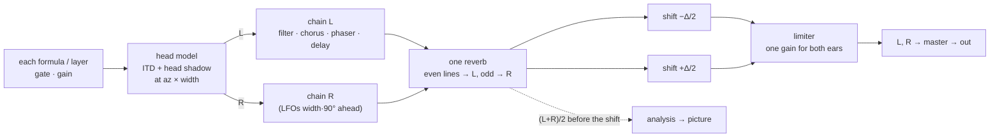

# Space and binaural beats

A point can be **wide** — its voices placed around the listener's head —
and it can **beat**: the left ear hears the whole sound a few hertz below
the right, and the brain hears the difference as a slow pulse that is in
neither ear. Both are heard only where an app plays **stereo, on
headphones**; on a speaker the same point plays in mono, exactly as it
always did. Code: `syn-core/src/spatial.rs` (the head model),
`syn-core/src/fx/hilbert.rs` (the beat), `fx/chain.rs` and `engine.rs`
(the stereo path); the decisions: [PLAN-BINAURAL.md](../PLAN-BINAURAL.md).

## In the point

```json
"audio": { "formulas": {
  "additive": { "enabled": true, "params": { "gain": 0.45, "fund": 55, "az": -35 } },
  "fm":       { "enabled": true, "params": { "gain": 0.15, "fc": 880, "az": 40 } } } },
"seq": { "layers": [ { "on": true, "sound": "owl", "az": -60, … } ] },
"bin": { "on": true, "beat": 6.0, "width": 0.8 }
```

| field | meaning | range (neutral) |
|---|---|---|
| `az` of a formula | where the voice sits: −90° full left, 0 ahead, 90° full right. One more slider of the formula; the generator itself never reads it | −90 … 90 (0) |
| `az` of a layer | the same, for a sample or drum layer | −90 … 90 (0) |
| `bin.width` | scales every azimuth, and how far the reverb's tails and the chorus/phaser differ between the ears. 0 is the mono image | 0 … 1 (0) |
| `bin.on` | the binaural beat is on | (off) |
| `bin.beat` | the beat, Hz — delta 0.5–4, theta 4–8, alpha 8–13, beta 13–30, gamma 30–40 | 0.5 … 40, log (0.5) |

A centred `az` is never written, and a `bin` section with the beat off
and width 0 is left out, so a point without space serializes — and gets
its id — exactly as before.

## The stereo path



1. **The head model** (`spatial.rs`, Brown & Duda's structural model). Each
   source reaches the far ear later, by Woodworth's delay
   τ = (a/c)(θ + sin θ) — up to 0.66 ms at 90° — and darker: a first-order
   head-shadow shelf lifts the top on the near side (up to +7 dB) and
   shadows it on the far side (down to −18 dB). Below ~1 kHz the ears tell
   a voice's side mostly by time, as real ears do. The shelf is taken
   relative to straight ahead, so a voice at 0° passes untouched. Front and
   back, and elevation, are not modelled.
2. **The chain runs twice**, once per ear, with the same settings. The
   right ear's chorus and phaser LFOs run `width` × 90° ahead of the left
   one's (a stereo chorus). The **reverb** is one room heard from both
   ears: its even delay lines in the left, its odd ones in the right, as
   far apart as the width says.
3. **The beat** (`hilbert.rs`) is a single-sideband frequency shifter on
   the whole mix after the reverb: every partial moves down by Δ/2 in the
   left ear and up by Δ/2 in the right, so the two ears are Δ apart
   whatever the note. A pair of all-pass chains (7 + 7 sections, designed
   for the sample rate) holds the two arms 90° apart to 0.03° from 20 Hz
   to 20 kHz; the shift itself is a rotating phasor, no `sin` per sample.
   Switching the beat on or off crossfades over 50 ms. The dry layers join
   after the chain and do not beat.
4. **One limiter for both ears**, driven by the louder one, so a loud
   voice on the left does not tip the image to the right.
5. **The analysis** — loudness, brightness, onsets, the spectrum the
   picture reads — hears (L + R)/2 *before* the shift (a shifted pair
   summed would tremble at the beat). At width 0 with the beat off, both
   ears are the mono render bit for bit, and so is everything the picture
   sees.

The azimuths, the width and the beat are LFO targets (`<formula>` · `az`,
`seq.<i>` · `az`, `bin` · `beat`, `width`), so a voice can wander around
the head and a beat can drift between bands.

## In the presets

*Magic forest* and *Sea shore* are the space presets: the drone ahead, the
other voices spread to both sides, the birds wandering round the head on a
pink LFO (the same LFO shifts the palette), the chimes swaying, width 1,
and a slow delta beat at 2 Hz. On a speaker they play as before.

## Mono and stereo apps

An app builds its player in one mode: `Player::new` (mono, what every app
played before) or `Player::new_stereo` — `AudioCore.createStereo` in the
web app's worklet, `SoundPlayer.newStereo` on Android and iOS. A stereo
player hands out interleaved L R frames (`render_stereo_into`,
`renderStereo`, `render_stereo`); either player answers either call — a
mono one puts its sound in both ears, a stereo one gives its downmix. The
engine never computes both. Whether headphones are on is the app's
business, not the point's: the point says how wide it is and how fast it
beats.

## In the search

`a.<formula>.az` (23), `seq.<i>.az` (4), `bin.on`, `bin.beat`, `bin.width`
are the genome's last 30 genes. An azimuth is gated by its voice; the
beat's rate by `bin.on`. A 🎲 point gets every voice somewhere within
±72° and a width of 0.3–0.8, never a beat; a rare structural move switches
the beat on (between 4 and 12 Hz) or off, and the continuous moves take it
from there. The scout scores the mono sound, so it does not hear space —
what is wide and what beats is the user's 👍 to decide.

## What it costs

`syn-bench --stereo` (native) and `syn-wasm`'s `stereo_cost` test (wasm)
measure it. On an M1, every voice spread and the beat on, the stereo
engine costs 1.2–1.75× the mono one natively and 1.2–1.55× in wasm; the
heaviest preset stays under 4 % of a core in wasm. The head model is
~7–10 ns a sample per source, the beat ~33 ns natively and ~55 ns in wasm
for both ears.
